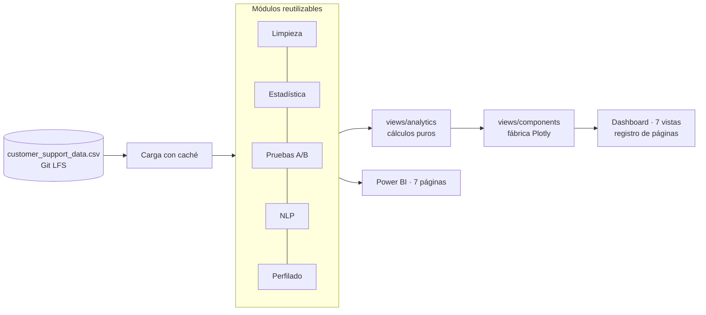

<p align="center"></p>

<h1 align="center">Customer Support Analytics</h1>

<p align="center"><b>Metrics, data quality and text analysis over real customer-support conversations.</b></p>

<p align="center"><a href="https://data-science-analytics-toolkit-emhnwgam9hemykfa8qe38r.streamlit.app/"><b>Live demo ↗</b></a></p>

<p align="center"></p>

<p align="center">
      
</p>

<p align="center"><a href="https://dodysalim.github.io/"><b>🌐 Portfolio</b></a> · <a href="README.md"><b>🇪🇸 Versión en español</b></a></p>

---

## 📌 At a glance

| | |
| --- | --- |
| **🎯 Problem** | Find channel, sentiment, urgency and outcome patterns in support conversations. |
| **🛠️ Solution** | Reusable modules for cleaning, statistics, A/B testing, NLP and data profiling. |
| **📈 Deliverables** | Interactive 7-view Streamlit dashboard and a 7-page Power BI report. |
| **🧪 Quality** | 12 automated tests run in CI; views tested with 50,000 real rows. |

## 🏗️ Architecture



## 🚀 How to run

```bash
pip install -r requirements.txt
git lfs pull   # large CSV
python -m streamlit run src/app/dashboard.py
python -m pytest tests -q
```

## ⚖️ Scope

The A/B comparison is observational and does not prove causality.

---

<p align="center">
<b>Dody Dueñas Remache</b> · Data Analyst / Data Scientist · Guayaquil, Ecuador (remote LATAM)<br>
<a href="https://dodysalim.github.io/">Portfolio</a> · <a href="https://github.com/dodysalim">GitHub</a> · <a href="https://www.linkedin.com/in/dody-duenas/">LinkedIn</a> · <a href="mailto:dodydurema67@gmail.com">dodydurema67@gmail.com</a>
</p>
